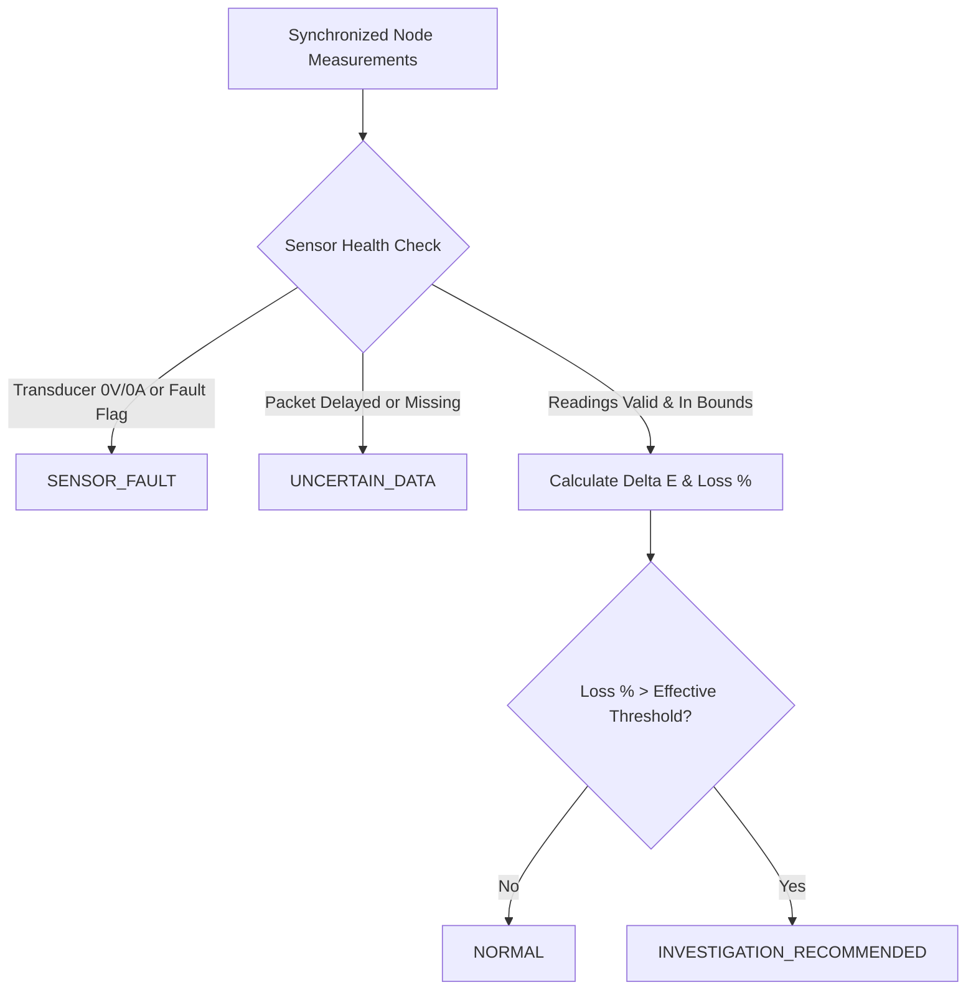

# Segment-Level Energy Loss Localisation Specification (TELDS)

## 1. Overview & Objectives
Traditional distribution monitoring only observes the total discrepancy between the secondary terminal of a distribution transformer and the sum of consumer revenue meters ($\Delta E = E_{tx} - \sum E_{consumer}$). While this detects the existence of energy loss, it offers **zero spatial granularity** along kilometers of overhead or underground feeder lines.

The **Segment-Level Energy Loss Localisation Engine** in TELDS upgrades this architecture by modeling the distribution feeder as multiple ordered physical measurement points ($P_0, P_1, P_2, P_3, P_4$) and evaluating energy conservation across discrete line segments ($P_0–P_1$, $P_1–P_2$, $P_2–P_3$, $P_3–P_4$).

---

## 2. Feeder Physical Topology Model

A standard 11kV/415V radial distribution feeder ring is modeled as five synchronized measurement nodes:

```
[ P0: 11kV Substation LV Bus ]
              |
              | Segment S1: P0–P1 (1.2 km, ACSR Dog, R=0.32Ω)
              v
[ P1: Sectionalizer Pole #14 ]
              |
              | Segment S2: P1–P2 (1.5 km, ACSR Dog, R=0.40Ω)
              v
[ P2: Sectionalizer Pole #28 ]
              |
              | Segment S3: P2–P3 (1.8 km, ACSR Dog, R=0.48Ω) ------> [ Lateral Branch: 5.0 kWh ]
              v
[ P3: Distribution Tap Pole #42 ]
              |
              | Segment S4: P3–P4 (0.9 km, ACSR Dog, R=0.24Ω)
              v
[ P4: Feeder End-of-Line Pole #56 ]
```

### Physical Line Properties
| Segment ID | Upstream | Downstream | Length ($L$) | Conductor | Resistance ($R$) | Baseline Tech Loss | Uncertainty Band ($U$) | Configured Threshold | Legitimate Branch |
|---|---|---|---|---|---|---|---|---|---|
| `SEG-P0-P1` | P0 | P1 | 1.2 km | ACSR Dog 100mm² | 0.320 $\Omega$ | 2.0% | ±1.5% | 5.5% | None (0.0 kWh) |
| `SEG-P1-P2` | P1 | P2 | 1.5 km | ACSR Dog 100mm² | 0.400 $\Omega$ | 2.4% | ±1.5% | 6.0% | None (0.0 kWh) |
| `SEG-P2-P3` | P2 | P3 | 1.8 km | ACSR Dog 100mm² | 0.480 $\Omega$ | 2.8% | ±1.5% | 6.5% | Commercial Tap (5.0 kWh) |
| `SEG-P3-P4` | P3 | P4 | 0.9 km | ACSR Dog 100mm² | 0.240 $\Omega$ | 1.8% | ±1.5% | 5.0% | None (0.0 kWh) |

---

## 3. Mathematical Formulation of Localisation

### 3.1 Segment Energy Balance
For any discrete segment bounded by upstream node $P_i$ and downstream node $P_{i+1}$:

$$\Delta E_{segment} = E(P_i) - \left[ E(P_{i+1}) + \sum_{k} E_{branch,k} \right]$$

$$\text{Discrepancy } \% = \left( \frac{\Delta E_{segment}}{E(P_i)} \right) \times 100$$

### 3.2 Technical Resistance ($I^2 R$) Loss Baseline
The ohmic line loss across 3-phase AC conductors is computed from RMS current and conductor resistance:

$$P_{tech\_loss} = 3 \cdot I_{rms}^2 \cdot R_{segment}$$

$$E_{tech\_loss} = \int P_{tech\_loss} \, dt \approx E(P_i) \cdot \left(\frac{\text{expected\_technical\_loss\_pct}}{100}\right)$$

### 3.3 Sensor Uncertainty Propagation
Current transformers (CTs) and potential transformers (PTs) have finite precision conforming to IEC 61869-2 standards:
- Split-core CTs: Class 1.0 ($\pm 1.0\%$ ratio error)
- Voltage divider / PT: Class 0.5 ($\pm 0.5\%$ ratio error)
- Dual-point RSS composite measurement uncertainty:
  $$U_{composite} = \sqrt{u_{CT,up}^2 + u_{PT,up}^2 + u_{CT,down}^2 + u_{PT,down}^2} \approx \pm 1.5\%$$

### 3.4 Effective Dynamic Detection Threshold
To prevent false alarms arising from instrument tolerance and weather variations:

$$\text{Threshold}_{effective} = \text{Configured Threshold} + U_{composite}$$

$$\text{Unexplained Loss } E_{unexp} = \max\left(0, \, \Delta E_{segment} - E_{tech\_loss}\right)$$

---

## 4. Status Classification Logic

Each segment is evaluated every synchronization cycle into one of four deterministic states:



1. **`NORMAL`**: $\text{Loss } \% \le \text{Threshold}_{effective}$. Throughput is fully accounted for within allowable line resistance and instrument tolerance.
2. **`INVESTIGATION_RECOMMENDED`**: $\text{Loss } \% > \text{Threshold}_{effective}$. Segment is formally highlighted on the dashboard as a **suspected location of abnormal energy discrepancy**.
3. **`SENSOR_FAULT`**: Hardware transducer open circuit, zero voltage during active load, or analog clipping. Adjacent segments transition to `SENSOR_FAULT` to prevent false theft accusations.
4. **`UNCERTAIN_DATA`**: Wireless packet dropped, packet latency exceeds timeout window ($\tau > 3000\text{ms}$), or timestamp sync mismatch. The algorithm **refrains from assigning an unverified location**.

---

## 5. Four Empirical Test Scenarios

| Scenario ID | Name | Feeder Input | Segment P2-P3 Loss | Flagged Segment | Status |
|---|---|---|---|---|---|
| `SCENARIO_NORMAL` | Normal Balanced Operation | 150.0 kWh | 3.01% (Normal) | None | All `NORMAL` |
| `SCENARIO_ANOMALY_P2_P3` | Localised Discrepancy | 150.0 kWh | 18.07% (Abnormal) | `SEG-P2-P3` | `INVESTIGATION_RECOMMENDED` |
| `SCENARIO_SENSOR_FAULT` | Hardware Sensor Fault | 150.0 kWh | 0.0% (Inhibited) | `SEG-P1-P2`, `SEG-P2-P3` | `SENSOR_FAULT` |
| `SCENARIO_MISSING_DATA` | Delayed Wireless Telemetry | 150.0 kWh | 3.01% (Downstream) | `SEG-P0-P1`, `SEG-P1-P2` | `UNCERTAIN_DATA` |

---

## 6. Assumptions and Limitations of the Localisation Method

> [!IMPORTANT]
> **Safety and Attribution Mandate:**
> A detected segment is strictly a **suspected location for field inspection**, NOT legal or operational proof of unauthorized power tapping. The system does not classify loss as theft.

### 6.1 Core Assumptions
1. **Synchronized Time Epochs:** Sensor nodes are assumed to sample synchronously within a ±250ms window via NTP/GPS timestamping.
2. **Conductor Homogeneity:** Conductor resistance is modeled using standard ACSR Dog specifications at 35°C ambient temperature.
3. **Branch Metering Completeness:** Known lateral branches must be equipped with sub-meters or have statistically documented average loads.

### 6.2 Limitations & Edge Cases
1. **Unmetered Distributed Loads:** Legitimate unmetered municipal streetlights or agricultural pumping connected between poles without smart meters will register as segment discrepancies.
2. **Temperature Variation:** Conductor temperature swings under heavy load change resistance by $+0.4\% / \text{°C}$, which is absorbed by the $\pm 1.5\%$ uncertainty band.
3. **Sub-Segment Resolution:** The system isolates discrepancy to the line segment between two sensor poles (e.g., within 1.8 km). Pinpointing the exact meter tap within that span requires field inspection.
4. **Uncertainty Halting:** If any sensor in the hop fails or delays transmission, the localisation algorithm refuses to guess, ensuring utilities avoid wrongful customer audits.

---

## 7. Simulation & Non-Physical Testing Declaration

> [!NOTE]
> All sensor telemetry, True RMS measurements, wireless RSSI signals, and cellular transmission packets described in this prototype and software codebase are **entirely simulated on a laptop host environment**. No physical live high-voltage installation or hardware grid connection is claimed.
